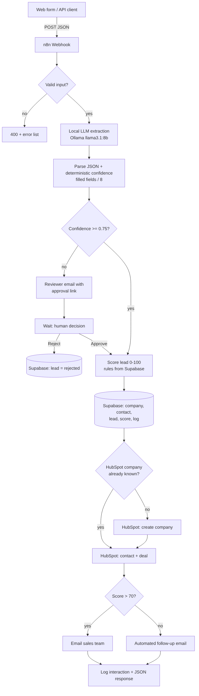

# AI Lead Qualification & CRM Automation

An n8n workflow that turns a free-text inbound lead (web form or API call) into a scored, deduplicated CRM record, and routes it to the right follow-up. Uncertain extractions go to a human reviewer by email before anything is written to the CRM.

Built as a portfolio project: self-hosted n8n, a local LLM, a relational database, a real CRM API, and a human-in-the-loop step.



## What it does

1. **Receives** a lead as JSON (`email`, `message`, optional `contact_name`, `company_name`, `phone`) on a webhook, usually from the included web form.
2. **Validates** it. Bad input gets an HTTP 400 with a list of errors.
3. **Extracts** structured data from the message with a local LLM (Ollama, `llama3.1:8b`): company, industry, project type, company size, budget range, urgency, timeline, requirements.
4. **Checks confidence.** Confidence is deterministic: the share of 8 extraction fields that came back filled. Below 0.75 (fewer than 6 of 8), the lead is held for review.
5. **Asks a human** when needed. The reviewer gets an email with the original message, the AI extraction, and an "Open and decide" button that opens an Approve / Reject form. Reject closes the lead as `rejected` and creates no CRM records.
6. **Scores** the lead 0-100 from four components: budget (max 30), urgency (20), company size (20), product fit (30). The rubric is read from the `scoring_rules` table, so it can be changed without touching the workflow.
7. **Writes to Supabase (PostgreSQL):** company, contact, lead, score, interaction log.
8. **Writes to HubSpot:** company, contact, and a deal with custom properties (`project_type`, `budget_range`, `lead_score`).
9. **Routes by score.** Above 70: email to the sales team. 70 or below: automated follow-up email to the lead.
10. **Responds** with a JSON summary (status, extraction, score, Supabase and HubSpot IDs). Leads held for review get a `pending_review` response right away, so the web form never waits on the human.

## Design decisions

- **Deterministic confidence instead of LLM self-reported confidence.** In testing, the 8B model's own `confidence_score` was not reliable. Counting filled fields is predictable and explainable.
- **Local LLM.** No lead data leaves the machine for extraction, and there is no per-call cost. The trade-off is some run-to-run variation near the thresholds.
- **Deduplication.** Contacts are matched on email. Companies are matched on email domain in Supabase, and the stored HubSpot company ID is reused so repeat leads from the same company do not create duplicate HubSpot companies. Free-mail domains (gmail.com, outlook.com and similar) are deliberately excluded, so unrelated people are not merged into one company.
- **Rubric in the database.** Scoring weights live in `scoring_rules`; the workflow falls back to built-in defaults if a row is missing.
- **Escaped SQL.** Values are escaped before being placed in queries; the test suite includes quotes, backslashes and an injection-style string.

## Stack

| Part | Tool |
|---|---|
| Orchestration | n8n (self-hosted, Docker) |
| LLM | Ollama, `llama3.1:8b` |
| Database | Supabase (PostgreSQL) |
| CRM | HubSpot (Company, Contact, Deal) |
| Email | Gmail (OAuth2) |
| Entry point | Static HTML form (`web-form/index.html`) |

## Repository layout

```
workflows/ai-lead-crm.json   n8n workflow (credentials and recipient addresses are placeholders)
sql/schema.sql               tables and the default scoring rubric
web-form/index.html          single-file lead form, posts to the webhook
tests/lead-test-suite.ps1    end-to-end test runner (PowerShell)
docs/architecture.png|.mmd   architecture diagram
```

## Setup

1. **Database.** Create a Supabase project and run `sql/schema.sql`.
2. **n8n.** Run n8n in Docker. Import `workflows/ai-lead-crm.json`.
3. **Credentials.** In n8n, create and select: a Postgres credential (Supabase connection), a HubSpot credential (Service Key / app token), and a Gmail OAuth2 credential.
4. **HubSpot properties.** Create custom deal properties `project_type`, `budget_range`, `lead_score`.
5. **Recipients.** Set the `To` address on `Send Approval Request Email` (reviewer) and `Sales Notification` (sales team).
6. **Ollama.** Install Ollama and `ollama pull llama3.1:8b`. The workflow reaches it at `http://host.docker.internal:11434`.
7. **Publish** the workflow. The endpoint is `POST http://localhost:5678/webhook/lead-intake`. The Webhook node allows all origins so the form can call it from a local file.
8. Open `web-form/index.html` in a browser and submit a lead.

### Example request

```bash
curl -X POST http://localhost:5678/webhook/lead-intake \
  -H "Content-Type: application/json" \
  -d '{
    "email": "jane@acmefiber.com",
    "contact_name": "Jane Doe",
    "company_name": "Acme Fiber",
    "message": "We need a 50 km fiber optic backbone in Istanbul this quarter. Budget is approved, around 500k USD."
  }'
```

## Testing

`tests/lead-test-suite.ps1` runs the workflow against a live instance and writes a Markdown report:

```powershell
.\tests\lead-test-suite.ps1 -BaseEmail you@gmail.com
```

It covers input validation (400s), a hot lead and a cold lead, Turkish characters, special characters, repeat email, repeat company on a corporate domain, and guided Approve and Reject paths. LLM-dependent tests are retried once and reported as `flaky` if the second attempt is the one that passes.

Last live run (n8n 2.34, Ollama llama3.1:8b, HubSpot and Supabase checked by hand): validation, hot lead, cold lead, special characters, repeat email, Approve, Reject, and corporate-domain company reuse all passed. One Turkish-language hot lead passed only on retry, and one repeat-email request scored 68 instead of above 70, because the local model's output varies near the thresholds.

## Known limitations

- **LLM variance near thresholds.** Scores close to 70 and confidence at exactly 0.75 can flip between runs.
- **No error handling or retries yet.** If Ollama, HubSpot or Postgres is down, the request fails and nothing is retried.
- **Reject sends no email to the lead.**
- **HubSpot company industry is not populated.**
- **Stale HubSpot IDs.** If a company is deleted in HubSpot but its `hubspot_id` remains in Supabase, the next lead for that company fails. Delete in HubSpot first, then clean Supabase.
- **`followups` table is reserved** for scheduled follow-ups and is not used yet.

## Possible next steps

Error-handling sub-workflow with retries, fuzzy company matching, a Slack alternative for notifications, versioned scoring rubrics, and a second CRM adapter.
